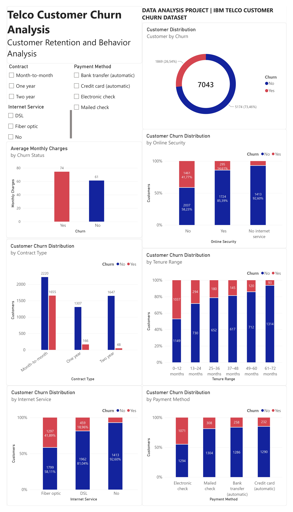

# Telco Customer Churn Analysis

# *An end-to-end data analytics project exploring customer churn patterns in the IBM Telco Customer Churn dataset using PostgreSQL and Power BI.*

## Project Overview

Customer churn is an important business concern for telecommunications companies. Understanding why customers leave can help businesses identify retention challenges and make more informed decisions. This project explores customer churn by examining customer demographics, contract types, internet services, payment methods, tenure, and monthly charges.

The project covers data inspection, cleaning, validation, exploratory SQL analysis, and dashboard development.

## Project Objectives
- Understand the distribution of customer churn.
- Identify customer groups with higher churn rates.
- Examine the relationship between contract types and churn.
- Explore how service subscriptions and payment methods relate to churn.
- Analyze customer tenure and monthly charges.
- Present the findings through an interactive Power BI dashboard.

## Tools and Technologies
- **PostgreSQL:** Data storage, cleaning, validation, and analysis.
- **SQL:** Exploratory data analysis and analytical queries.
- **pgAdmin 4:** PostgreSQL database management.
- **Visual Studio Code:** SQL development environment.
- **Power BI Desktop:** Data visualization and dashboard development.

## Dataset: IBM Telco Customer Churn Dataset

The dataset contains 7,043 customer records and 21 columns, covering customer demographics, subscribed services, account information, and churn status. The original CSV file is named WA_Fn-UseC_-Telco-Customer-Churn.csv. The dataset was obtained from Kaggle. Refer to the original dataset page for its source and usage terms. [https://www.kaggle.com/datasets/yeanzc/telco-customer-churn-ibm-dataset]

## Project Workflow

The project workflow is divided among eight sql files. They are:

1. Data Inspection
- Uploaded the data to a PostgreSQL database.
- Examined the dataset structure, columns, and data types.
- Checked for missing, blank, and whitespace values.
- Reviewed the distribution and distinct values of categorical columns.
- Identified 11 blank values in TotalCharges, which corresponded to customers with zero tenure.
- Confirmed that there are no NULLs, no whitespace, and no other blank values.

2. Data Cleaning
- Created a cleaned table named customer_churn_cleaned.
- Converted numerical columns to appropriate data types, as all data types were converted to TEXT during the upload to PostgreSQL.

3. Data Validation (Data Value Check)
- Checked for duplicate customer IDs.
- Checked for duplicate records.
- Validated categorical values and numerical ranges.
- Confirmed 7,043 unique customer records.

4. Exploratory Data Analysis with SQL.
Used SQL to investigate:
- Overall churn distribution and churn rate.
- Churn across customer demographics
- Churn by contract type and services.
- Churn by payment method.
- Financial characteristics, including monthly and total charges.
- Customer tenure and tenure groups.

5. Power BI Dashboard Development
Developed an interactive Power BI dashboard to present the analysis. The dashboard includes:
- Customer churn distribution.
- Churn by contract type.
- Churn by tenure range.
- Churn by internet service.
- Churn by payment method.
- Churn by online security subscription.
- Average monthly charges by churn status.
- Interactive slicers allow users to explore the data by contract, internet service, and payment method.

## Key Findings

The exploratory analysis revealed several patterns:
- **Overall churn:** 1,869 customers churned, representing approximately 26.54% of the dataset.
- **Contract type:** Month-to-month customers had a substantially higher churn rate than customers with one-year or two-year contracts.
- **Internet service:** Fiber-optic customers had a higher churn proportion than DSL customers.
- **Payment method:** Customers using electronic checks showed a higher churn proportion than customers using the other payment methods.
- **Tenure:** Churn was more prevalent among customers with shorter tenure.
- **Online security:** Customers without online security had a higher churn proportion than customers who subscribed to the service.
- **Monthly charges:** Customers who churned had higher average monthly charges than customers who remained.

These findings describe associations within the dataset and should not be interpreted as evidence of causation.

## Repository Structure
```
customer-churn-analysis/
├── data/
│   └── WA_Fn-UseC_-Telco-Customer-Churn.csv
├── power-bi/
│   ├── customer-churn-analysis.pbix
│   └── customer-churn-analysis.pdf
├── sql/
│   ├── 01_data_inspection.sql
│   ├── 02_data_cleaning.sql
│   ├── 03_data_value_check.sql
│   ├── 04_data_churn_analysis.sql
│   ├── 05_demographic_analysis.sql
│   ├── 06_contract_and_service_analysis.sql
│   ├── 07_financial_analysis.sql
│   └── 08_tenure_analysis.sql
├── dashboard.png
└── README.md
```
## Dashboard Preview


## Conclusion

This project provided practical experience working with a relational database, cleaning and validating data, writing SQL queries for exploratory analysis, and communicating findings through data visualization.

It demonstrates an end-to-end approach to a customer churn analysis problem, from raw data inspection to an interactive dashboard.